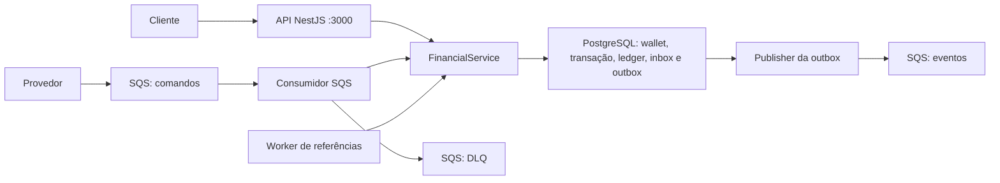
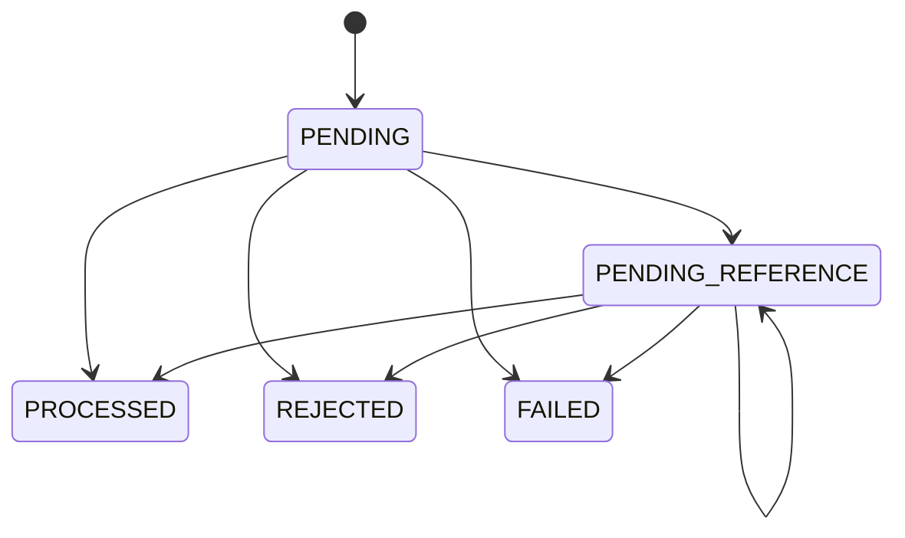

# Como funciona o projeto

Este guia explica a implementação do **Distributed Wagering Processor**, desde o recebimento de uma operação até sua persistência, publicação de eventos e recuperação após falhas.

O objetivo é servir como roteiro de estudo, execução local e apresentação técnica. As explicações correspondem à implementação da branch `refactor/otimizacao`, após o commit `a27a922`.

## Índice

1. [O problema resolvido](#1-o-problema-resolvido)
2. [Tecnologias e processos](#2-tecnologias-e-processos)
3. [Arquitetura e organização](#3-arquitetura-e-organização)
4. [Modelo financeiro](#4-modelo-financeiro)
5. [Banco de dados e garantias](#5-banco-de-dados-e-garantias)
6. [Fluxo HTTP](#6-fluxo-http)
7. [Idempotência e concorrência](#7-idempotência-e-concorrência)
8. [Fluxo SQS e recuperação](#8-fluxo-sqs-e-recuperação)
9. [Outbox e eventos](#9-outbox-e-eventos)
10. [Referências fora de ordem](#10-referências-fora-de-ordem)
11. [Principais classes e funções](#11-principais-classes-e-funções)
12. [Como executar localmente](#12-como-executar-localmente)
13. [Exemplo prático pela API](#13-exemplo-prático-pela-api)
14. [Como executar e entender os testes](#14-como-executar-e-entender-os-testes)
15. [Logs, métricas e health checks](#15-logs-métricas-e-health-checks)
16. [Decisões, limitações e diagnóstico](#16-decisões-limitações-e-diagnóstico)
17. [Roteiro para estudar e apresentar](#17-roteiro-para-estudar-e-apresentar)

## 1. O problema resolvido

O sistema mantém carteiras de jogadores e processa operações enviadas por provedores de jogos: apostas, ganhos, perdas e reversões.

A dificuldade principal é preservar o dinheiro quando uma operação chega repetida, quando duas instâncias disputam o mesmo saldo ou quando um processo cai durante o processamento.

Exemplo: uma carteira tem `100.00 BRL` e recebe duas apostas de `80.00 BRL` simultaneamente. O resultado correto é uma aposta processada, outra rejeitada e saldo final de `20.00 BRL`. Não pode haver saldo negativo nem dois débitos confirmados.

O projeto também precisa manter um histórico auditável: toda mudança de saldo possui um lançamento no ledger. Uma soma independente desse histórico deve resultar no saldo armazenado na carteira.

Alguns termos usados:

| Termo | Significado neste projeto |
| --- | --- |
| Wallet | Carteira de um jogador em uma moeda |
| Transação de negócio | Aposta, ganho, perda, abertura ou reversão |
| Transação SQL | Bloco de alterações confirmado ou revertido atomicamente pelo PostgreSQL |
| Ledger | Histórico imutável de créditos e débitos |
| Commit | Confirmação da transação SQL |
| Replay | Retorno do resultado já persistido para uma operação repetida |
| Inbox | Registro persistido de mensagens recebidas |
| Outbox | Registro persistido de eventos que precisam ser publicados |
| Ack | Remoção da mensagem SQS após seu tratamento |
| DLQ | Fila que preserva mensagens inválidas ou com falhas repetidas |
| Backoff | Intervalo crescente antes de uma nova tentativa |
| TTL | Prazo máximo de espera; aqui, usado para referências pendentes |

## 2. Tecnologias e processos

| Tecnologia | Uso |
| --- | --- |
| Bun | Executar TypeScript, instalar dependências e rodar testes |
| TypeScript estrito | Verificar contratos e tipos durante o desenvolvimento |
| NestJS | Organizar a API HTTP, controllers e injeção de dependências |
| TypeORM | Mapear dados, executar consultas e controlar transações SQL |
| PostgreSQL | Persistir dados e garantir constraints, locks e atomicidade |
| decimal.js | Fazer cálculos monetários exatos sem converter dinheiro para `number` |
| AWS SDK para SQS | Receber, publicar e confirmar mensagens |
| LocalStack | Disponibilizar SQS local para desenvolvimento e testes |
| Docker Compose | Iniciar PostgreSQL e LocalStack |

Existem dois processos da aplicação, executados pelo Bun:

- **API**, iniciada em `src/main.ts`: atende operações e consultas HTTP, normalmente na porta `3000`.
- **Worker**, iniciado em `src/worker.ts`: executa consumidor SQS, publisher da outbox e reprocessamento de referências. Expõe health e métricas na porta `3001`.

O Compose atual executa as dependências, não a API nem o worker. Estes são iniciados em terminais separados.



Os três workers são loops assíncronos no mesmo processo Bun. É possível iniciar outros processos para aumentar o paralelismo; a consistência continua dependendo do banco.

## 3. Arquitetura e organização

A organização separa regras financeiras, coordenação dos casos de uso e detalhes de infraestrutura.

```text
src/
  domain/                       Regras e objetos financeiros
  application/                  Casos de uso e contratos
  infrastructure/
    database/                   TypeORM, mappers, schemas e migrations
    http/                       Controllers, filtro de erros e logs HTTP
    messaging/                  SQS, publisher, referências e runtime
    observability/              Métricas, diagnósticos e sondas
  app.module.ts                 Composição das dependências da API
  bootstrap.ts                  Criação da aplicação NestJS
  main.ts                       Entrada da API
  worker.ts                     Entrada do processo de workers
scripts/
  migrate.ts                    Aplicação e reversão de migrations
tests/
  unit/                         Domínio e mapeamentos
  integration/                  PostgreSQL, HTTP, SQS e observabilidade
  concurrency/                  Disputa entre processos reais
  support/                      Processos auxiliares para os testes
```

### Domínio

As classes em `domain` não importam NestJS ou TypeORM. Elas conhecem regras como saldo insuficiente, moeda incompatível, referência inválida e transação terminal.

As instâncias nascem por factories, como `Money.from`, `Wallet.open` e `WagerTransaction.create`. A factory `rehydrate` reconstrói o estado vindo do banco sem executar novamente uma operação financeira.

### Aplicação

`FinancialService` coordena o processamento: valida a entrada, procura duplicatas, adquire o lock da wallet, chama o domínio e solicita a persistência.

Ele depende de interfaces:

- `FinancialStore`: executa uma transação SQL.
- `FinancialSession`: disponibiliza as operações de persistência dentro dessa transação.
- `FinancialDiagnostics`: registra divergência de reconciliação.

Isso permite que o caso de uso seja compartilhado por HTTP e SQS sem depender dos respectivos transportes.

### Infraestrutura

`TypeOrmFinancialStore` implementa o contrato de persistência. Cada callback recebe uma sessão usando o mesmo `EntityManager` transacional.

O mapeamento usa `EntitySchema`, mantendo os decorators do ORM fora do domínio. Os mappers convertem explicitamente linhas do banco em objetos de domínio e vice-versa.

HTTP traduz requisições e respostas. Mensageria cuida de recebimento, visibilidade, ack e publicação. Observabilidade fornece recursos compartilhados, sem fazer o worker depender de controllers HTTP.

## 4. Modelo financeiro

### Money

O contrato monetário é:

```json
{ "amount": "25.00", "currency": "BRL" }
```

O valor é uma string com exatamente duas casas decimais. Internamente, `Money` utiliza decimal.js; no PostgreSQL, utiliza `NUMERIC(20,2)`, lido como string.

Não há conversão monetária para `number`. Usos de `number` no projeto representam contadores, versões, portas e durações.

As moedas aceitas são BRL e USD. Operar entre moedas diferentes gera erro. Entradas negativas, notação científica, `NaN`, `Infinity` e formatos fora do contrato são rejeitados.

`Money` é imutável: `add`, `subtract` e `negate` devolvem outro objeto. Valores negativos são permitidos em representações internas, como a diferença da reconciliação, mas não em entradas financeiras externas ou saldos de wallet.

### Wallet

Existe no máximo uma carteira por combinação `playerId + currency`.

A versão começa em `1` e só aumenta quando o saldo muda. Abertura com saldo positivo cria uma transação `OPENING` e um crédito de ledger na mesma transação SQL. Abertura com zero não gera lançamento financeiro.

### Tipos de operação

| Operação | Comportamento |
| --- | --- |
| `OPENING` | Crédito interno de abertura; não é aceito como comando externo |
| `BET` | Debita a aposta se houver saldo |
| `WIN` | Credita um ganho |
| `LOSS` | Registra a perda sem movimentar saldo; o contrato exige `0.00` |
| `REFUND` | Devolve integralmente o valor de uma BET processada |
| `ROLLBACK` | Inverte integralmente uma BET, WIN ou REFUND processada |

As demais operações externas exigem valor positivo. `WIN` e `LOSS` podem informar referência a uma BET. `REFUND` e `ROLLBACK` exigem referência.

A referência é localizada por provedor e ID externo. Deve pertencer ao mesmo provedor, jogador, wallet, moeda e rodada.

Um rollback de WIN ou REFUND debita dinheiro. Se não houver saldo, recebe `REVERSAL_INSUFFICIENT_FUNDS`. A operação é rejeitada e auditada, sem saldo negativo.

**Escolha de negócio:** o projeto impede qualquer segunda reversão processada da mesma referência, inclusive alternando REFUND e ROLLBACK. Essa regra é mais restritiva que a formulação de unicidade por tipo do desafio. Um ROLLBACK do próprio REFUND continua possível, pois referencia outra transação.

### Estados da transação



`PROCESSED`, `REJECTED` e `FAILED` são terminais. O domínio não permite novas transições e o banco bloqueia alterações desses registros.

`PENDING` normalmente existe apenas em memória durante o processamento inicial. O serviço persiste o resultado processado, rejeitado ou aguardando referência.

Uma rejeição de negócio não é um erro de conexão: ela é um resultado persistido, com `failureCode` e evento correspondente.

## 5. Banco de dados e garantias

| Tabela | O que guarda |
| --- | --- |
| `wallets` | Saldo materializado, moeda, jogador e versão |
| `wager_transactions` | Identidade, payload financeiro, estado, resultado original e agendamento de referência |
| `wallet_ledger_entries` | Crédito/débito, saldo anterior/posterior e versão da wallet |
| `inbox_messages` | Identidade da mensagem recebida, hash e conclusão |
| `outbox_messages` | Envelope do evento, tentativas, próximo envio e publicação |

A migration inicial cria constraints e triggers além das tabelas:

- Unicidade da carteira por jogador/moeda, da chave de idempotência e do ID externo por provedor.
- Unicidade de lançamento por transação/wallet e de posição na sequência do ledger.
- Saldo não negativo, valores finitos e aritmética correta dos lançamentos.
- Bloqueio de atualização, exclusão e truncamento do ledger.
- Proteção dos dados de identidade da wallet e do payload/estado terminal da transação.
- Validação da continuidade entre lançamentos.
- Verificações diferidas para o commit, relacionando wallet, ledger e transação processada.

As verificações diferidas permitem gravar os objetos em uma ordem conveniente dentro da transação, mas exigem consistência quando ela termina.

`synchronize` e migrations automáticas estão desabilitados. O schema é alterado por migrations explícitas.

### Reconciliação

O saldo da wallet é rápido de consultar. O ledger permite reconstruí-lo:

```text
saldo reconstruído = soma dos créditos - soma dos débitos
diferença = saldo armazenado - saldo reconstruído
```

`reconcile()` adquire o lock da wallet antes de comparar os dois valores. Se encontrar divergência, responde `consistent: false`, registra log e incrementa métrica. Não ajusta o saldo automaticamente.

## 6. Fluxo HTTP

Ao receber `POST /wagering/transactions`:

1. O controller recebe o body, a chave `Idempotency-Key` e a correlação.
2. O caso de uso valida campos, IDs, tipo de operação e dinheiro.
3. Calcula o hash canônico do payload de negócio.
4. Abre uma transação SQL e procura uma operação anterior.
5. Adquire o lock da wallet e verifica a chave novamente.
6. Carrega a referência, quando informada, e chama `Wallet.apply()`.
7. Persiste transação, lançamento, wallet e eventos da outbox, conforme o resultado.
8. Confirma o commit e devolve a resposta.

Se uma gravação falhar, toda a transação SQL é revertida. O teste que injeta falha na outbox confirma que não sobra um débito parcial.

### Rotas

| Método | Rota | Finalidade |
| --- | --- | --- |
| POST | `/wallets` | Criar carteira |
| GET | `/wallets/:walletId` | Consultar saldo e versão |
| GET | `/wallets/:walletId/ledger` | Consultar histórico paginado |
| POST | `/wallets/:walletId/reconciliation` | Comparar saldo e ledger |
| POST | `/wagering/transactions` | Submeter operação |
| GET | `/wagering/transactions/:transactionId` | Consultar pelo ID interno |
| GET | `/providers/:providerId/wagering/transactions/:externalTransactionId` | Consultar pelo identificador do provedor |
| GET | `/health/live` | Verificar que o processo responde |
| GET | `/health/ready` | Verificar banco e filas |
| GET | `/metrics` | Consultar métricas Prometheus |

O ledger aceita `limit` de 1 a 100 e `cursor`. O cursor é opaco, restrito à wallet e baseado em sua versão; não é um token de autorização.

### Códigos HTTP

| Código | Uso |
| --- | --- |
| 201 | Wallet criada |
| 200 | Operação processada ou consulta bem-sucedida |
| 202 | Operação aguardando referência |
| 400 | Contrato inválido |
| 404 | Recurso ausente |
| 409 | Conflito de identidade, idempotência ou wallet duplicada |
| 413 | Corpo maior que o limite do parser |
| 422 | Operação rejeitada por regra de negócio |
| 503 | Indisponibilidade transitória; inclui `Retry-After` |
| 500 | Erro interno ou resposta de uma transação `FAILED` |

Consultar uma transação rejeitada retorna `200`, pois a consulta funcionou. Submeter novamente a mesma operação rejeitada retorna `422` com replay. Respostas internas não expõem SQL ou credenciais.

## 7. Idempotência e concorrência

### Como a repetição é reconhecida

A chave de idempotência é global e persistida com restrição única. Também existe unicidade para `(providerId, externalTransactionId)`.

O hash SHA-256 usa JSON com chaves ordenadas recursivamente e somente os campos de negócio. Não inclui correlação ou metadados do transporte.

| Situação | Resultado |
| --- | --- |
| Mesma chave e mesmo payload | Replay do registro existente |
| Mesma chave e payload diferente | Conflito |
| Mesmo ID externo/provedor com outra chave | Conflito |
| Mesmo ID externo em provedores distintos | Identidades distintas |

O replay devolve o saldo observado no processamento original, não o saldo atual da carteira. Não cria novo ledger nem novos eventos.

Na entrada SQS, a inbox acrescenta a identidade `(consumerName, messageId)`. Seu hash considera o payload financeiro e a chave de idempotência. Reutilizar o mesmo `messageId` com outro conteúdo é conflito.

### Como a disputa pelo saldo é resolvida

O banco usa `SELECT ... FOR UPDATE` na wallet em uma transação `READ COMMITTED`.

No exemplo de duas apostas de 80:

1. Uma instância trava a wallet e lê saldo 100.
2. A outra aguarda o mesmo lock.
3. A primeira debita 80 e confirma saldo 20.
4. A segunda obtém o lock, lê 20 e rejeita sua aposta.

Wallets diferentes podem ser processadas em paralelo. Não existe lock global financeiro.

A chave é consultada novamente após adquirir o lock porque outra instância pode ter concluído a operação enquanto a atual aguardava.

O adaptador define espera de lock de 3 segundos e timeout SQL de 10 segundos nas transações financeiras. Repete até duas vezes após deadlock, falha de serialização ou timeout de lock, abrindo nova transação. Falha de conexão com commit incerto não é repetida automaticamente nesse nível: o cliente pode consultar ou reenviar a mesma chave.

## 8. Fluxo SQS e recuperação

As filas locais são:

| Fila | Papel |
| --- | --- |
| `wager-transactions.fifo` | Comandos financeiros de entrada |
| `wager-transactions-dlq.fifo` | Mensagens que exigem investigação |
| `wager-events.fifo` | Eventos produzidos pelo sistema |

O envelope de entrada contém `messageId`, `type: "WagerTransactionRequested"`, `occurredAt` e `data`. A chave `idempotencyKey` vai dentro de `data`. O [README](README.md#entrada-sqs) mostra o JSON completo.

O consumidor recebe uma mensagem por chamada. No runtime, usa long polling de até 20 segundos, visibilidade de 30 segundos e renovação periódica enquanto processa.

Ele chama o mesmo `FinancialService.submit()` usado pelo HTTP, adicionando o contexto da inbox. A inbox participa da mesma transação SQL da movimentação.

### Tratamento por resultado

| Resultado | Comportamento da mensagem |
| --- | --- |
| Processada | Commit e depois ack |
| Rejeição de negócio | Resultado terminal persistido e ack |
| Referência pendente | Agendamento persistido e ack; o worker de referências assume |
| Contrato inválido ou conflito | Envio à DLQ antes de confirmar a origem |
| Falha transitória | Nova tentativa com backoff |
| Limite de recebimentos alcançado | Encaminhamento à DLQ |

A configuração normal limita a cinco recebimentos. O contador vem do SQS. Nos testes, os limites e a visibilidade são menores para reproduzir as situações rapidamente.

Se o envio para a DLQ falhar, o consumidor não confirma a origem. Se o banco ainda estiver indisponível ao esgotar retries, a mensagem preservada na DLQ é a evidência durável; o registro SQL de `FAILED` não pode ser garantido naquele instante.

### E se o processo morrer?

- **Antes do commit:** o banco desfaz o trabalho; a mensagem pode ser entregue novamente.
- **Depois do commit e antes do ack:** a nova entrega encontra a operação persistida e faz replay.
- **Depois do commit, sem publicar os eventos:** a outbox continua pendente e outro publisher pode publicá-la.

Em `SIGINT`/`SIGTERM`, o worker interrompe novos recebimentos, aguarda o trabalho em andamento e fecha conexões. Os testes também encerram processos de forma abrupta para exercitar recuperação.

## 9. Outbox e eventos

Publicar diretamente no SQS durante a movimentação criaria uma situação problemática: o envio poderia funcionar e o commit financeiro falhar, ou o contrário.

Por isso, o caso de uso grava primeiro o envelope na tabela `outbox_messages`, junto da transação financeira. Um processo separado faz o envio posteriormente.

`OutboxPublisher.publishOnce()`:

1. Abre uma transação SQL.
2. Seleciona um evento devido usando `FOR UPDATE SKIP LOCKED` e `LIMIT 1`.
3. Publica com grupo da wallet e deduplicação baseada no `eventId`.
4. Marca a publicação e confirma a transação.
5. Se o envio falhar, persiste tentativas e próximo agendamento.

`SKIP LOCKED` permite que outro publisher selecione outro evento sem esperar pelo já reservado.

Uma queda após o envio e antes da marcação pode causar publicação repetida. Portanto, a entrega é **pelo menos uma vez**: o consumidor externo precisa deduplicar por `eventId`. Não existe um consumidor downstream de produção neste repositório.

### Eventos emitidos

| Evento | Quando |
| --- | --- |
| `WagerTransactionProcessed` | Transação processada, incluindo abertura positiva e LOSS |
| `WagerTransactionRejected` | Rejeição de negócio |
| `WalletBalanceChanged` | Mudança efetiva de saldo |
| `WagerTransactionPendingReference` | Aceite aguardando referência |
| `WagerTransactionFailed` | Registro auditável de falha de infraestrutura esgotada |

O envelope tem ID, tipo, versão, aggregateId, correlação, causação opcional, data e dados serializados. Valores monetários permanecem strings.

O runtime agora publica o próximo evento imediatamente após terminar o anterior. Espera 250 ms somente quando não encontra trabalho devido. O backoff de falha de publicação cresce até 60 segundos. Cada evento mantém sua própria transação SQL.

A transação fica aberta durante o envio ao SQS, limitado a 5 segundos. Essa escolha simplifica reserva e recuperação, mas ocupa uma conexão durante a chamada de rede. Publishers concorrentes também não garantem ordem global de envio; eventos de saldo carregam `walletVersion`.

## 10. Referências fora de ordem

Um REFUND pode chegar antes da BET que pretende devolver. A operação fica `PENDING_REFERENCE`, sem crédito no ledger.

O agendamento inicial é de aproximadamente 1 segundo. O worker consulta lotes de até 20 candidatas e chama `reprocessReference()`.

Esse método:

1. Confirma que a transação ainda está pendente.
2. Adquire o mesmo lock de wallet usado pelo processamento inicial.
3. Relê estado e agendamento.
4. Procura a referência e tenta aplicar a operação.
5. Persiste o resultado e os eventos, ou agenda outra tentativa.

O backoff cresce até 15 minutos. O prazo máximo é de 24 horas e o limite é de 100 tentativas. Na centésima tentativa, uma referência disponível ainda pode ser processada; se continuar ausente, a operação é rejeitada com `REFERENCE_NOT_FOUND`.

Dois workers podem selecionar a mesma candidata, mas a releitura sob lock impede que ambos apliquem a movimentação.

## 11. Principais classes e funções

Os links abaixo apontam para os arquivos de implementação.

| Classe/arquivo | Funções principais e responsabilidade |
| --- | --- |
| [Money](src/domain/money.ts) | `from`, `rehydrate`, `add`, `subtract`, `equals`, `toJSON`: precisão, moeda e serialização |
| [Wallet](src/domain/wallet.ts) | `open`: abertura; `apply`: validar e aplicar operação; `validateReference`: verificar vínculo e tipo da referência |
| [WagerTransaction](src/domain/wager-transaction.ts) | `create`, `opening`, `markProcessed`, `markPendingReference`, `reject`, `fail`: identidade e transições |
| [WalletLedgerEntry](src/domain/wallet-ledger-entry.ts) | `create`, `isBalanced`, `rehydrate`: lançamento imutável e aritmética |
| [InboxMessage](src/domain/inbox-message.ts) | `receive`, `matches`, `markProcessed`, `rehydrate`: estado da mensagem recebida |
| [OutboxMessage](src/domain/outbox-message.ts) | `enqueue`, `isDue`, `scheduleRetry`, `markPublished`: cópia do envelope e agendamento |
| [FinancialService](src/application/financial-service.ts) | `createWallet`, `submit`, `reprocessReference`, `auditDeliveryFailure`, consultas e `reconcile`: coordenação financeira |
| [Contratos](src/application/contracts.ts) | `parseWallet`, `parseTransaction`, `uuid`, `identifier`, `parseLedgerPage`: validação compartilhada |
| [Hash do payload](src/application/transaction-payload.ts) | `hashTransactionPayload`: representação canônica para detectar conflitos |
| [FinancialStore](src/application/financial-store.ts) | Interfaces de persistência e diagnóstico usadas pela aplicação |
| [TypeOrmFinancialStore](src/infrastructure/database/typeorm-financial-store.ts) | `transaction`: transação e retry SQL; sessão interna: consultas, locks e escritas |
| [Mappers](src/infrastructure/database/financial-mappers.ts) | Conversão entre linhas TypeORM e objetos do domínio |
| [FinancialController](src/infrastructure/http/financial.controller.ts) | Rotas financeiras e escolha do status da resposta |
| [ApiExceptionFilter](src/infrastructure/http/api-exception.filter.ts) | Traduz erros em respostas HTTP estáveis, sem expor detalhes internos |
| [SqsConsumer](src/infrastructure/messaging/sqs-consumer.ts) | `pollOnce`, `process`, `ack`, `visibility`, `stop`: ciclo de recebimento e confirmação |
| [OutboxPublisher](src/infrastructure/messaging/outbox-publisher.ts) | `publishOnce`: reserva, envio e marcação de um evento |
| [ReferenceWorker](src/infrastructure/messaging/reference-worker.ts) | `runOnce`: busca de referências pendentes para reprocessar |
| [WorkerRuntime](src/infrastructure/messaging/worker-runtime.ts) | `start`, `loop`, `stop`: coordenação dos três loops |
| [Operations](src/infrastructure/observability/operations.ts) | `ready`, `collect`, `stop`: sondas e coleta com cache |
| [OperationalMetrics](src/infrastructure/observability/metrics.ts) | `increment`, `gauge`, `observe`, `render`, `log`: contadores, histograma e saída JSON |
| [FinancialDiagnosticsService](src/infrastructure/observability/financial-diagnostics.ts) | Acrescenta o registro de divergências financeiras às métricas |
| [ProviderAuthGuard](src/infrastructure/http/provider-auth.guard.ts) | Ponto de extensão explícito; atualmente libera o acesso |

Algumas funções do domínio servem à modelagem e aos testes, enquanto certas operações do adaptador usam SQL diretamente. A fronteira responsável pela atomicidade é sempre a transação de `FinancialStore`.

## 12. Como executar localmente

### Preparação

É necessário ter Bun e Docker Desktop com containers Linux. A versão de Bun usada na validação foi `1.4.3`.

Na pasta do projeto:

```powershell
bun install --frozen-lockfile
if (!(Test-Path .env)) { Copy-Item .env.example .env }
bun run infra:up
docker compose ps
bun run migration:run
```

O comando de migrations é necessário para executar a aplicação no banco de desenvolvimento. Os testes preparam os próprios bancos.

### Iniciar os processos

No primeiro terminal:

```powershell
bun run dev
```

No segundo terminal, na mesma pasta:

```powershell
bun run worker
```

Para executar o código compilado:

```powershell
bun run build
# Primeiro terminal:
bun run start:prod
# Segundo terminal:
bun run worker:prod
```

### Configuração

O Bun carrega `.env`. Não é necessário copiar as credenciais do exemplo para código-fonte.

| Variável | Finalidade |
| --- | --- |
| `PORT` | Porta da API; padrão 3000 |
| `WORKER_PORT` | Porta de health/métricas do worker; padrão 3001 |
| `POSTGRES_PORT` | Porta publicada pelo Compose; padrão 55432 |
| `DATABASE_URL` | Banco da aplicação |
| `TEST_DATABASE_ADMIN_URL` | Conexão local com permissão de criar bancos temporários |
| `AWS_REGION` | Região usada pelo cliente SQS |
| `AWS_ACCESS_KEY_ID`, `AWS_SECRET_ACCESS_KEY` | Credenciais locais do SDK; valores de teste no exemplo |
| `SQS_ENDPOINT` | Endpoint LocalStack; padrão localhost:4566 |
| `SQS_QUEUE_URL` | Fila de comandos |
| `SQS_DLQ_URL` | Fila de falhas |
| `SQS_EVENTS_QUEUE_URL` | Fila de eventos |

A porta PostgreSQL `55432` evita conflito com uma instalação existente em `5432`. Ao trocar a porta publicada, atualize também as URLs do banco.

Para encerrar os processos, use `Ctrl+C` nos terminais. Depois:

```powershell
bun run infra:down
```

O volume do PostgreSQL é preservado. As filas locais são recriadas pelo script de inicialização ao recriar o container LocalStack.

`bun run migration:revert` desfaz a última migration. A reversão da migration inicial remove tabelas e dados; não é um passo de limpeza rotineiro.

## 13. Exemplo prático pela API

Com a API funcionando, execute no PowerShell:

```powershell
$base = 'http://localhost:3000'

# 1. Criar carteira com abertura de 100 reais.
$wallet = Invoke-RestMethod -Method Post -Uri "$base/wallets" `
  -ContentType 'application/json' -Body (@{
    playerId = [guid]::NewGuid().ToString()
    initialBalance = @{ amount = '100.00'; currency = 'BRL' }
  } | ConvertTo-Json -Depth 5)

# 2. Preparar uma aposta de 25 reais.
$externalId = [guid]::NewGuid().ToString()
$headers = @{
  'Idempotency-Key' = "provider-a:$externalId"
  'x-correlation-id' = 'demo-aposta'
}
$operation = @{
  providerId = 'provider-a'
  externalTransactionId = $externalId
  walletId = $wallet.id
  playerId = $wallet.playerId
  roundId = 'round-1'
  gameId = 'game-1'
  kind = 'BET'
  money = @{ amount = '25.00'; currency = 'BRL' }
} | ConvertTo-Json -Depth 5

# 3. Processar: saldo esperado 75.00, idempotentReplay false.
$first = Invoke-RestMethod -Method Post -Uri "$base/wagering/transactions" `
  -ContentType 'application/json' -Headers $headers -Body $operation
$first

# 4. Repetir exatamente a mesma operação: nenhum débito adicional.
$replay = Invoke-RestMethod -Method Post -Uri "$base/wagering/transactions" `
  -ContentType 'application/json' -Headers $headers -Body $operation
$replay

# 5. Consultar saldo, histórico, transação e reconciliação.
Invoke-RestMethod "$base/wallets/$($wallet.id)"
Invoke-RestMethod "$base/wallets/$($wallet.id)/ledger?limit=10"
Invoke-RestMethod "$base/wagering/transactions/$($first.transactionId)"
Invoke-RestMethod -Method Post -Uri "$base/wallets/$($wallet.id)/reconciliation"
```

Nesse exemplo, o ledger terá um crédito de abertura de 100 e um débito de 25. A reconciliação deve retornar diferença `0.00`.

Reexecutar o bloco inteiro cria uma nova carteira e uma nova operação. Para demonstrar replay, repita somente a chamada usando o mesmo `$operation` e `$headers`.

## 14. Como executar e entender os testes

### Validação completa

Com Docker Desktop aberto, na pasta do projeto:

```powershell
bun install --frozen-lockfile
if (!(Test-Path .env)) { Copy-Item .env.example .env }
bun run infra:up
bun run typecheck
bun run build
bun test --timeout 30000
```

Na validação do commit `a27a922`, passaram **191 testes**: 88 unitários, 98 de integração e 5 de concorrência.

`typecheck` verifica tipos; `build` compila; os testes executam comportamentos. São verificações complementares.

Não é preciso iniciar API ou worker manualmente para a suíte. Os testes criam os processos necessários, aplicam migrations nos bancos temporários e criam filas próprias para mensageria.

### Executar grupos ou um cenário

```powershell
bun run test:unit
bun run test:integration
bun run test:concurrency

bun test tests/integration/http-api.test.ts --timeout 30000
bun test tests/integration/messaging.test.ts --timeout 30000
bun test tests/integration/observability.test.ts --timeout 30000

bun test tests/integration/messaging.test.ts --test-name-pattern 'centésima' --timeout 30000
```

### O que cada conjunto comprova

| Suíte | Exemplos de cobertura |
| --- | --- |
| Unitários | Dinheiro, moedas, saldo, referências, estados terminais, hash, mappers e outbox |
| Schema financeiro | Constraints, triggers, migrations reversíveis, ledger e atomicidade real |
| HTTP | Contratos, rotas, replay, conflitos, erros, paginação e rollback |
| LocalStack | Existência das filas e configuração FIFO/DLQ |
| Mensageria | Inbox, redelivery, DLQ, backoff, referências, publishers concorrentes e quedas |
| Observabilidade | Readiness, logs, métricas, cache, lock real e reconciliação divergente |
| Concorrência | Três processos, 50 duplicatas, disputa de saldo, independência de wallets e reinício |

As suítes financeiras de integração verificam a igualdade entre saldo e soma do ledger. Para exercitar divergência, um teste desabilita temporariamente um trigger somente em banco descartável e restaura a consistência antes da limpeza.

Os testes de queda usam processos reais, sinalizam um ponto controlado e encerram o processo ali. Isso permite reproduzir situações difíceis de acertar apenas com atrasos aleatórios.

Os logs podem conter erros esperados durante testes de falha. O resultado final relevante é a contagem de testes e falhas.

### Isolamento

Os bancos temporários têm prefixo `wagering_test_`. As filas de mensageria têm prefixo aleatório `test-`. A limpeza não aponta para o banco financeiro de desenvolvimento.

A conexão de testes deve ser local e permitir criação de bancos. Uma interrupção forçada do próprio executor pode deixar recursos temporários para investigação e limpeza posterior.

## 15. Logs, métricas e health checks

### Logs

Os logs da aplicação usam JSON e identificadores disponíveis, como `correlationId`, `transactionId`, `walletId` e `providerId`. Mensagens SQS também possuem `messageId`.

O HTTP recebe ou gera `x-correlation-id`, devolve esse header e usa a correlação nos eventos. Não registra corpo financeiro, saldos, chave de idempotência ou headers de autorização.

### Health

```powershell
Invoke-RestMethod http://localhost:3000/health/live
Invoke-RestMethod http://localhost:3000/health/ready
Invoke-RestMethod http://localhost:3001/health/ready
```

Liveness responde se o processo está vivo. Readiness consulta PostgreSQL e os atributos das três filas; não recebe nem remove mensagens. Retorna `200` quando as verificações passam e `503` quando alguma falha ou o processo já está encerrando.

Readiness não comprova todas as permissões futuras de escrita nem substitui testes funcionais. Ela verifica a disponibilidade das dependências pelas sondas implementadas.

### Métricas

```powershell
(Invoke-WebRequest http://localhost:3000/metrics).Content
(Invoke-WebRequest http://localhost:3001/metrics).Content
```

As métricas cobrem resultados por estado, duplicatas, retries, DLQ, conflitos de lock, reconciliação, latência, quantidade de eventos pendentes e atraso da outbox.

Existem duas naturezas de dados:

- **Contadores e histogramas locais:** pertencem ao processo e reiniciam com ele. Não são o registro contábil.
- **Gauges consultados no banco:** representam estado compartilhado. Réplicas podem observar o mesmo total; somá-las duplicaria a contagem.

As consultas SQL de métricas usam cache local de cinco segundos. Scrapes simultâneos compartilham uma coleta. Contadores locais continuam atuais e readiness não usa esse cache.

Uma indisponibilidade pode, portanto, coexistir por alguns segundos com gauges do último scrape bem-sucedido. Quando uma nova coleta falha, seus gauges são removidos e `*_collection_success` passa a zero. O cache não participa de idempotência, validação de saldo ou decisões financeiras.

O atraso da outbox é a idade do evento pendente mais antigo, incluindo eventos em backoff. É zero quando não há pendências. O contador de DLQ registra encaminhamentos confirmados pelo processo, não o tamanho atual da fila.

## 16. Decisões, limitações e diagnóstico

### Escolhas importantes

- A integridade financeira depende de PostgreSQL, constraints e locks por wallet.
- FIFO e deduplicação SQS são otimizações; não substituem idempotência persistida.
- A outbox evita perder a intenção de publicar após o commit financeiro.
- Publicação repetida continua possível e precisa de deduplicação downstream.
- O ledger é de créditos e débitos por wallet; não foi implementada contabilidade de partidas dobradas.
- A autenticação está aberta por decisão explícita. `ProviderAuthGuard` é um ponto de extensão, não uma proteção.
- Uma integração futura poderia validar tokens de um IdP via OIDC/JWKS e autorizar o provedor e as wallets acessíveis. O `providerId` do body não seria prova de identidade.
- Não houve benchmark de throughput, teste em conta AWS real, dashboard ou tracing distribuído.

### Problemas comuns

| Sintoma | O que conferir |
| --- | --- |
| Docker não responde | Docker Desktop aberto e configurado para containers Linux |
| Conexão PostgreSQL falha | `docker compose ps`, porta 55432 e URLs do `.env` |
| Tabelas não existem na execução manual | Aplicar `bun run migration:run` no banco configurado |
| Testes não criam banco | Permissão de criação e `TEST_DATABASE_ADMIN_URL` local |
| Porta da API/worker ocupada | Ajustar `PORT` ou `WORKER_PORT` no terminal correspondente |
| Readiness 503 | Observar flags de PostgreSQL/SQS e conferir as três filas |
| Evento permanece na outbox | Worker iniciado, fila de saída acessível e próximo agendamento devido |
| Referência não processa imediatamente | Backoff, existência e identidade da referência, TTL e estado atual |
| Replay parece devolver saldo antigo | É intencional: devolve o saldo observado na operação original |
| Métrica SQL não muda imediatamente | Cache de cinco segundos e intervalo entre scrapes |
| Mensagem na DLQ | Investigar `failureCode`, payload e resultado persistido antes de reenviar |

Ao repetir uma mensagem transitória, preserve `messageId`, chave de idempotência e payload. Uma transação terminal não volta a ser processada por replay. Não altere registros terminais para forçar uma movimentação.

Para múltiplas instâncias, use portas diferentes e o mesmo banco/filas. Por exemplo, em outro terminal:

```powershell
$env:PORT = '3002'
bun run start
```

Workers adicionais precisam de `WORKER_PORT` distinto. O teste de concorrência já automatiza a execução de três processos da API.


Documentos complementares:

- [README.md](README.md): início rápido, exemplos e comandos.
- [ARCHITECTURE.md](ARCHITECTURE.md): decisões técnicas e trade-offs.
- [CHALLENGE_REVIEW.md](CHALLENGE_REVIEW.md): revisão de aderência e correções encontradas.
